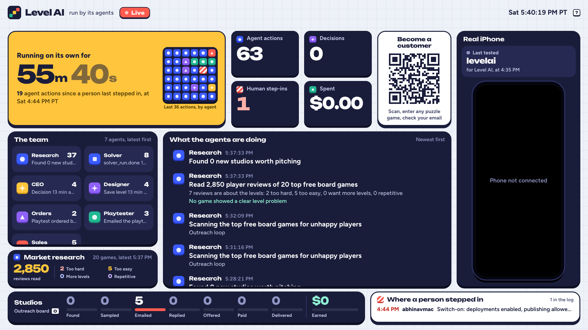
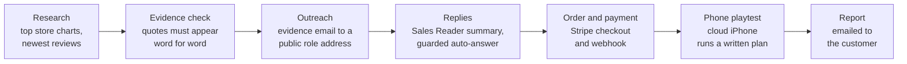
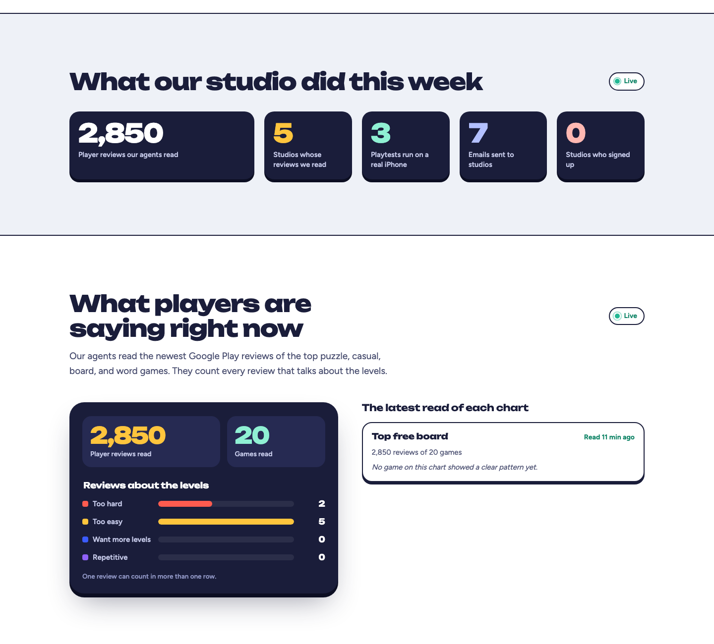
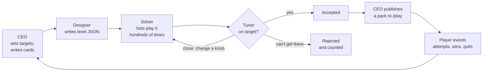

<p align="center">
  
</p>

<p align="center"><sub>The team's console on Nov 7 at 5:40 PM PT, built only from log rows. "Spent $0.00" isn't real spend: see <a href="#status-and-limits">Status and limits</a>.</sub></p>

<p align="center">
  <b>A level studio for mobile puzzle games, run by AI agents.</b><br>
  Agents read what players say about the top puzzle games, email the studios with the evidence, design and test levels with bot players, playtest apps on a real cloud iPhone, take payment, and answer replies. Every step lands in one live log.
</p>

<p align="center">
  
  
  
  
  
  
</p>

<p align="center">
  <a href="#try-it">Try it</a> ·
  <a href="#how-it-works">How it works</a> ·
  <a href="#the-agents">Agents</a> ·
  <a href="#what-runs-on-its-own">Autonomy</a> ·
  <a href="#numbers">Numbers</a> ·
  <a href="#status-and-limits">Limits</a> ·
  <a href="#run-it">Run it</a> ·
  <a href="#team">Team</a>
</p>

> [!IMPORTANT]
> Level AI is a hackathon prototype, built in 22 hours at the Naïve × YC Autonomous Company Hackathon in San Francisco (Nov 7–8, 2026). Payments run in Stripe test mode, and real revenue is $0. No agent-made level has passed tuning yet. Every number below says when it was taken.

## Why

Puzzle games live on new levels, and players notice fast when a level is too hard, too easy, or the same as the last one. They say so in store reviews. Level AI turns those reviews into a sales lead, and turns level design into something an agent can measure: a level ships only when bot players hit the win rate it was designed for.

The question behind the hackathon was how much of a company agents can run without a person. Level AI is our answer for one small business: finding studios, selling to them, delivering playtests, and making levels.

## Try it

| Link | What's there |
|---|---|
| [levelai.vercel.app](https://levelai.vercel.app) | The company's site, with live counts and "What players are saying right now," refreshed from the agents' market research |
| [levelai.vercel.app/play](https://levelai.vercel.app/play) | The web player for published levels. It shows "New levels are on the way" until the first agent-made pack is published. |
| [levelai.vercel.app/playtest](https://levelai.vercel.app/playtest) | Order a playtest of your app on a real iPhone ($5, test mode) |
| [levelai.vercel.app/join](https://levelai.vercel.app/join) | Name your puzzle game; the agents read its reviews and email you what they found |

The console in the screenshot above is the team's live view of the log. It's password protected, so it isn't linked here.

## How it works

Two loops share one database and one activity log.

### Finding and serving customers



1. **Research** reads the top 30 games on one of 15 Google Play charts (top free, top-grossing, and top paid for puzzle, casual, word, board, and card games), then each game's newest reviews. It counts reviews that say the levels are too hard, too easy, repetitive, or that ask for more levels.
2. **Evidence check.** A game needs at least 3 matching reviews. A model (`gpt-5.4-mini`, strict JSON) then confirms each sentence is a real complaint about that game's levels. It may only add sentences that appear word for word in a review. Counts, quotes, and the pitch are rebuilt from the confirmed sentences.
3. **Outreach.** The email states only numbers that came from research, quotes one player, and carries a postal address and an opt-out line. It goes only to a role address (`contact@`, `support@`, and similar) from the store listing or a domain search, never to a person's own address. A daily cap and an opt-out list are enforced in code, and a draft can't be changed after it's checked.
4. **Replies.** An inbound email wakes the Sales Reader in its own session, so the agent that sends never reads raw email. A clearly positive reply gets one fixed answer within a minute. A clear no closes the lead. Anything mixed, long, hostile, or a real question waits for a person.
5. **Order and payment.** A playtest order makes a Stripe payment link. The webhook records each payment once and queues the playtest.
6. **Playtest.** The Playtest Lead writes a JSON plan, and a Mobilerun agent carries it out on a cloud iPhone in Safari. A blank-screen check fails a run instead of reporting a white page as played. Plans never buy, sign in, share, or tap ads.
7. **Report.** The result is emailed to the customer. Between orders, the phone runs a market study of a free web puzzle game every 30 minutes.

<table>
  <tr>
    <td></td>
  </tr>
  <tr>
    <td valign="top"><b>The public site.</b> Live counts and market research, read from the same tables. Captured Nov 7 at about 5:49 PM PT.</td>
  </tr>
</table>

### Making levels



Each game plugs in through an adapter: a JSON Schema for a level, `validate`, `simulate(level, bot, seed)` that runs in Node with no browser, an exact `solve` where the genre allows one, and a URL that loads a saved level. The browser game and the Solver import the same adapter, so there's one copy of each game's rules.

The Solver plays each level with every bot the game defines and reports the win rate with a 95% Wilson interval. Seeds come from the run id, so any run can be replayed exactly. The Tuner compares the reference bot's win rate with the target and changes the move limit or layout until the level lands within a few points, or rejects it. An hour after a decision, the CEO calls `check_decision`, which compares win and quit rates on the levels the decision touched against the same game's untouched levels, before and after.

| Game | Genre | Difficulty measure |
|---|---|---|
| Gem Garden (`match3`) | Match-3 | Bot win rate. Uses the MIT-licensed Houseki Gem Swap engine. |
| Splash Sort (`watersort`) | Water sort | Exact solver (minimum pours) plus a bot that plays like a person |
| Turbo Lanes (`racer`) | Lane racer | Exact solver over fixed ticks |
| Mosslight Trails (`platformer`) | Grid platformer | Shortest route under jump limits, plus seeded bots. No browser client yet. |
| Lot Escape (`lotescape`) | Parking puzzle | Breadth-first solver. Adapter written, not yet in the platform's registry. |

## The agents

The core agents are a Naïve Team: a CEO coordinator and a roster that works from board cards. Each one has a daily budget cap and a per-task cap, and gets only the tools its job needs (MCP tools allow-listed by name).

| Agent | Runs on | What it does | When |
|---|---|---|---|
| **CEO** | Naïve | Reads production metrics, player stats, and the board; checks earlier decisions; makes at most three changes, each with a reason; writes cards; publishes accepted levels | Every hour |
| **Designer** | Naïve | Writes levels from the game's skill and schema | Design cards |
| **Tuner** | Naïve | Queues Solver runs, compares results with the target, retunes, accepts, or rejects | Tune cards |
| **Solver** | Node worker, no model | Claims queued runs (`for update skip locked`, so several workers can share the queue) and plays them | Polls the queue |
| **Research** | Naïve, and the outreach loop | Reads charts and reviews, ranks studios with a reason a person can check, finds public role contacts | Naïve every 4 hours; outreach loop every 10 minutes |
| **Sales Sender** | Naïve, and the outreach loop | Drafts and sends evidence emails through the guarded tools | Outreach cards; outreach loop |
| **Sales Reader** | Naïve | Reads one inbound reply and writes a summary | Inbound email webhook |
| **Playtest Lead** | Naïve, and the playtest loop | Turns an order into a phone plan, runs it, emails the report | Paid orders first; otherwise every 30 minutes |
| **Finance** | Naïve | Spend, revenue (test and live kept apart), cost per accepted level, overruns | Every 3 hours |
| **Marketing** | Naïve, and the social loop | Posts one update with the latest research numbers to the connected social accounts (X so far) | Naïve every 6 hours; social loop every 2 hours |

The outreach, playtest, and social loops are timers in the business server. They call the same guarded tools the Naïve agents use, and they log under the same agent names. So far, most emails went out through the outreach loop.

Studios can also reach the agents from their own coding agent: `levelai.vercel.app/studio-mcp` is an MCP server with `request_playtest`, `audit_reviews`, `request_free_levels`, and `get_status`, behind a key the site emails on request.

## What runs on its own

These run with nobody at the keyboard, each with a cap and a kill switch:

- The outreach loop: research, evidence check, contact lookup, and send (up to 3 emails a pass, 40 a day). Off with `OUTREACH_AUTOPILOT=0`; sending is off with `OUTREACH_SEND=0`.
- Answers to positive studio replies (one per studio, 10 a day). Off with `AUTO_REPLY=0`.
- Order → payment → playtest → report, end to end. Proven once with a test card and no browser: the webhook verified the payment, the iPhone ran the playtest, and the report was emailed, labeled as a test order.
- The iPhone playtest loop. Off with `PLAYTEST_LOOP=0`.
- The social loop. Off with `SOCIAL_LOOP=0`.
- The Naïve cron jobs above, and the Solver worker.
- Watchdogs that restart the business server, the console, the Solver worker, and their public tunnels when they die.

Every agent action is a row in `activity_log`, and every human step-in is a row in `interventions` with who, what, and why. The console's "Running on its own for" timer counts from the newest step-in. Nobody types those numbers in.

**Where a person stepped in** (as of Nov 7, 6:12 PM PT):

- **Logged:** 1 step-in. Abhinav switched the company on at 4:44 PM PT (deployments enabled, publishing allowed).
- **Setup a person did:** set prices, caps, and kill switches; connected the social accounts; wrote and restarted the code all afternoon. We're still building, so the unattended run is planned for 2:00 to 8:00 AM PT on Nov 8.
- **Blocked on a person:** the CEO's first live session (4:50 PM PT) was held by Naïve's rule that a chat which has read people's data asks for approval on every call. It tripped on our own metrics, which had counts such as `emails_sent`. We didn't approve it. A fix at 5:35 PM PT moved those counts to Finance's tool, so the CEO reads only production numbers. A live CEO run hasn't confirmed the fix yet.
- **Needs a person on the phone:** the cloud iPhone sometimes stops on an Apple Account sign-in screen. We filed a support ticket with Mobilerun.

## Numbers

Taken from the public endpoints on **Nov 7, 2026, at 6:11 PM PT** (Nov 8, 02:11 UTC):

| From `/public-stats` | Value |
|---|---|
| Player reviews read | 3,150 |
| Studios audited | 6 |
| Emails sent to studios | 8 |
| Playtests run on the iPhone | 5 |
| Studios who signed up | 0 |

| From `/market-research` (2 chart passes) | Value |
|---|---|
| Games read | 22 |
| Reviews read | 3,150 |
| Reviews saying the levels are too hard | 4 |
| Reviews saying the levels are too easy | 8 |
| Reviews asking for more levels | 0 |
| Reviews calling the levels repetitive | 0 |
| Games with a clear pattern in these passes | 0 |

The market-research table was added at 5:33 PM PT, so reviews read before then aren't in either count. The studios emailed earlier came from passes that predate it.

Read-only counts from the database at **6:12 PM PT**:

| | Value |
|---|---|
| Activity log rows, since 2:52 PM PT | 111 |
| Human step-ins logged | 1 |
| Payments | 1 test payment of $5 (the team's own order). Real revenue: $0. |
| Agent-made levels accepted | 0 |
| Packs published | 0 |
| Player events | 0 |
| CEO decisions | 4, all smoke tests. The console hides them, so it shows 0. |

## Status and limits

- **No agent-made level has been accepted yet.** The design → tune → solve path works end to end on a throwaway local database (Splash Sort accepted at 49% for a 50% target, Turbo Lanes at 54%), but not yet in production. `/play` is empty until the first pack is published, and the free-levels offer in our emails depends on it.
- **Match-3 is hard to tune with one knob.** In our tunability eval, the greedy bot's win rate jumps from 26% to 43% to 60% to 100% as the move limit goes from 6 to 11, so the Tuner hit 0 of 5 middle targets. A second knob or a faster bot is the fix.
- **No real revenue.** Stripe runs in test mode, and live keys are refused unless `BILLING_ALLOW_LIVE=1`. The one payment is a $5 test order we placed ourselves to prove the path. We don't count it as revenue.
- **No real replies or signups yet.** The auto-answer was tested with our own reply.
- **The CEO hasn't made a real decision yet.** Its first session stalled on the approval rule above. The four decisions in the log are smoke tests.
- **The phone plays web pages.** The cloud iPhone runs our levels and free web games in Safari. App Store apps are limited to Mobilerun's catalog, Google Play links are refused at order time, and a queued order is held in memory, so a server restart drops it.
- **The business server runs on a laptop.** Research calls the Monid CLI and drafts live in memory, so the server runs on Noel's laptop behind a Cloudflare quick tunnel, and the site forwards its live pages there. Watchdogs restart a dead server or tunnel within about a minute. If the laptop is off, the live pages fail.
- **Spend is only partly logged.** Until 6:18 PM PT, log rows carried no cost, which is why the console showed "Spent $0.00." Research passes now log Monid's reported cost. OpenAI calls, Mobilerun minutes, and Naïve usage aren't in the log yet, so "Spent" undercounts.
- **Evidence covers recent reviews only.** Counts come from each game's newest reviews (often 150), not its full history. A keyword match is checked by a model, and only exact quotes survive, but a model can still misread a review.
- **Social posting covers X only.** The first post went out at 6:11 PM PT. The other platforms aren't connected, and attempts on them failed.
- **Emails carry the email provider's footer** and display name. That's an inbox setting we haven't changed.

## Stack

| Tool | What it does here |
|---|---|
| [Naïve](https://vetta.sh/docs/llms.txt) | The agents: the Team (CEO and roster), board cards, budgets, per-tool permissions, cron, skills per game, the CRM mirror, and social posting |
| [Mobilerun](https://docs.mobilerun.ai/llms.txt) | The cloud iPhone, driven by its task agent (`mobilerun/mobile-agent-fast`) from a written plan |
| Monid | Google Play and App Store charts and reviews, and domain searches for public role addresses |
| AgentMail | The sales inbox: sends, receives, and keeps threads |
| Stripe | Payment links and the webhook, in test mode |
| Neon | Postgres for every table the console reads, and Neon Functions for the platform MCP server |
| Vercel | The site, the web player, and the console's password-protected address |
| OpenAI | `gpt-5.4-mini` for the evidence check, capped by `OPENAI_DAILY_CALLS` |

Everything is TypeScript on Node.js 22: two MCP servers (platform and business), the Solver worker, the console, and the game clients.

## Repo layout

| Folder | What it holds | Owner |
|---|---|---|
| [`platform/`](platform/) | Neon schema, the platform MCP server, the Naïve Team setup (`naive/src/roster.ts`), demo-readiness checks, and the [contracts](platform/CONTRACTS.md) | Abhinav |
| [`business/`](business/) | Research, outreach, replies, billing, finance, the lead form, phone playtests, and the business MCP server | Noel |
| [`demo/`](demo/), [`demo.sh`](demo.sh) | The console: one live screen built from the activity log | Noel |
| [`solver/`](solver/) | The Solver worker | Pinara |
| [`evals/`](evals/) | Pipeline evals, the tunability set, and `check_decision` | Pinara |
| [`games/`](games/) | One folder per game: adapter, rules, bots, `SKILL.md`, and browser client | Max (match-3, platformer, Lot Escape), Pinara (Splash Sort, Turbo Lanes) |
| [`site/`](site/), [`player/`](player/) | The public site and the web player | Noel |
| [`docs/`](docs/) | The [team plan](docs/plan.md), the [master plan](docs/master-plan.md), and the [agent plan](docs/agent-plan.md) | Everyone |
| [`log.md`](log.md) | The build log: what each push changed and why | Everyone |

## Run it

You need Node.js 22 or later, [`cloudflared`](https://developers.cloudflare.com/cloudflare-one/connections/connect-networks/), the `monid` CLI with a key added (`monid keys add`), a Neon database, and accounts for the tools above. Keys go in a repo-root `.env`, which is gitignored.

```sh
cp business/.env.example .env    # then fill in the values; never commit them

# Database: platform tables first, then the business tables on top
(cd platform/mcp && npm install && npm run migrate:dev)
psql "$DATABASE_URL" -f business/src/db/schema.sql

# The Naïve Team: roster, budgets, cron, and one CEO run
(cd platform/naive && npm install && npm run setup && npm run ceo-now)

# The business server with a public tunnel, and its watchdog
business/live.sh
(business/keepalive.sh > /tmp/levelai-biz-keepalive.log 2>&1 &)

# A Solver worker that restarts itself
(./solver-keepalive.sh &)

# The console on :4545, its password-protected public address, and its watchdog
./demo.sh
demo/console.sh
(demo/keepalive.sh > /tmp/levelai-keepalive.log 2>&1 &)
```

The variables, by part. Names only; see each `.env.example`.

| Part | Variables |
|---|---|
| Database | `DATABASE_URL` |
| Naïve | `NAIVE_API_KEY`, `NAIVE_BASE_URL`, `SALES_READER_AGENT_ID`, `NAIVE_API_KEY_SOCIAL`, `NAIVE_SOCIAL_IDENTITY_ID`, `PLATFORM_MCP_URL`, `MCP_BEARER_TOKEN`, `BUSINESS_MCP_URL`, `BUSINESS_MCP_TOKEN` |
| Research | `MONID_API_KEY`, `OPENAI_API_KEY`, `OPENAI_MODEL`, `OPENAI_DAILY_CALLS` |
| Email | `AGENTMAIL_API_KEY`, `AGENTMAIL_INBOX_ID`, `AGENTMAIL_WEBHOOK_SECRET`, `OUTREACH_SEND`, `OUTREACH_DAILY_CAP`, `OUTREACH_AUTOPILOT`, `COMPANY_NAME`, `COMPANY_POSTAL_ADDRESS` |
| Billing | `STRIPE_SECRET_KEY`, `STRIPE_WEBHOOK_SECRET`, `BILLING_ALLOW_LIVE`, `PLAYTEST_PRICE_USD`, `PILOT_PRICE_USD`, `PILOT_LEVELS`, `HINT_PACK_PRICE_USD` |
| Phone | `MOBILERUN_API_KEY`, `MOBILERUN_DEVICE_ID`, `MOBILERUN_MODEL`, `PLAYTEST_LOOP`, `PLAYTEST_LOOP_MINUTES` |
| Social | `SOCIAL_LOOP`, `SOCIAL_LOOP_MINUTES`, `SOCIAL_DAILY_CAP` |
| Solver | `WORKER_ID`, `POLL_MS`, `STALE_MINUTES`, `SOLVER_THREADS`, `SOLVER_MAX_SECONDS` |
| Server | `PORT`, `PUBLIC_BASE_URL`, `BUSINESS_BASE_URL`, `GAMES_BASE_URL` |

`business/live.sh` writes the tunnel's address into `.env` and the site's forwarding rules on each start. The console reads the same `.env`; [`demo/README.md`](demo/README.md) lists its own settings and keys. Each package has `npm test` and `npm run typecheck`.

## How we built it

Four people built Level AI between 1:00 PM on Nov 7 and the 11:00 AM code freeze on Nov 8, most of us working with a coding agent (Claude Code or Codex). Each person owns a folder. Shared interfaces are written down in [`platform/CONTRACTS.md`](platform/CONTRACTS.md) and the [master plan](docs/master-plan.md). A pre-push hook and a CI check block any push that doesn't add an entry to [`log.md`](log.md), so the log records what changed, why, and how it was checked.

## Team

| | Owned |
|---|---|
| **Noel Sason** | Business ops as agents: research, outreach, replies, billing, finance, and the lead form; phone playtests on Mobilerun; the console and the demo |
| **Maxim Balabanski** | Game integration: the match-3 and platformer adapters and clients, Lot Escape, hosting |
| **Abhinav Malviya** | The Naïve backbone: Neon, the platform MCP server, the Naïve Team setup, the CEO loop, and the demo-readiness checks |
| **Pinara** | Level quality: the Solver, bot players and solvers, the Designer and Tuner, evals, `check_decision`, Splash Sort, and Turbo Lanes |

Built at the [Naïve](https://usenaive.ai) × YC Autonomous Company Hackathon, San Francisco, Nov 7–8, 2026.

## License and credits

This repository doesn't have a license file yet.

- The match-3 rules engine in [`games/match3/engine/houseki-gem-swap/`](games/match3/engine/houseki-gem-swap/) is the headless Gem Swap engine from [Houseki](https://github.com/johnmorrisdotca/houseki) (version 0.5.0) by John Morris, used under the [MIT License](games/match3/engine/LICENSE). We didn't copy Houseki's campaign levels or demo assets.
- Every game here has its own name and art. Commercial games are genre references only, and none of their names, art, music, or levels are used.
- The player quotes in our emails and on the outreach board come from public store reviews, and we never name the reviewer.
