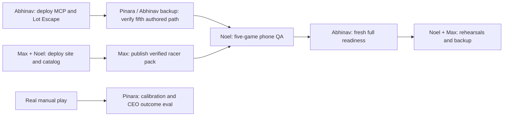

# Agent handoff: finish production integration after Pinara's quality work

Updated **November 8, 2026, about 04:17 PT**. Read this after pulling, together with the newest
entries in [log.md](../log.md). [master-plan.md](master-plan.md) remains the authority for ownership,
backups and deadlines. This document records implementation evidence and remaining operations;
it does **not** transfer ownership or declare the whole company production-ready.

## Is Pınar finished?

**Pinara's planned implementation is complete:** packages 8 (Solver/bots), 10 (Designer/Tuner),
11 (evals/CEO expected-versus-result), plus the requested game UI/mechanics and finite production
pipeline. No new feature implementation is currently assigned to her by this handoff.

**Her final quality sign-off is still pending dependencies.** Four hosted games have a real
Naïve-authored level accepted with current 200-game evidence. The fifth, Lot Escape, cannot save
through the deployed MCP adapter yet. Real player calibration and CEO before/after evidence also
need actual data. Pinara remains the quality owner and the master plan's **02:00–08:00 on-call
person for agents/solvers/levels**; Abhinav is the named backup for her three packages. After the
host owners deploy, finish the dependent checks below, rather than rebuilding her work.

Evidence: [quality completion details](pinara-quality-handoff.md) and
[machine-readable results](evidence/pinara-quality-2026-11-08.json).

## Current evidence and its limits

| Area | Observed result | What still has to happen |
|---|---|---|
| Source | Quality changes through `f0d27198e77fe6f24e8ebbd6ab5fbcf3bf1a01c8` are on `origin/main` | Pull into a clean checkout; a GitHub push does not deploy hosts |
| Tests | 146 passed: solver 61, evals 13, racer 23, sort 14, lot 20, platformer 7, match-3 8; final guard also passed focused checks | Repeat relevant checks if changing code; docs-only pulls do not require rerunning all suites |
| Browser QA | Takeover/undo/cancel/replay and four-game paired telemetry checks passed; saved match-3 won with seven pointer swaps, progressed and resumed | Deploy those bundles, then verify the actual production URLs and real phone paths |
| Live platform schemas, rechecked about 04:12 | match3, watersort, racer, platformer: HTTP 200; **lotescape: HTTP 404** | Abhinav deploy the registered fifth adapter/current tools |
| Quality agents | Designer **v14**, Tuner **v13**; five explicit Designer schedules, existing caps preserved | Repin CEO's coordinator roster; confirm cron/kill-switch state against live API |
| Real authored verification | At unchanged 50% target: match-3 **56%**, racer **51%**, water **53.5%**, platformer **45.5%**, all 200 games | Lot Escape retry after backend deployment. Match-3 uses the documented CI allowance |
| Racer catalog | All opening 100 positions verified: 69 originals + 31 child revisions, each 200 games | Deploy client/manifest, then guarded publication; the new repair pack is **not published** |
| Runtime | Pinara heartbeat `pinara-quality-f0d2719`, all five games + stub; watchers use committed `5b4468a`, all five buffers healthy | Noel reload his older worker; don't restart Pinara's healthy processes unnecessarily |
| Stored readiness | Pinara's 04:03 run: queue green, authored path red only for Lot Escape | Rerun after deployment; current check requires recent authored evidence, not compiler stock |
| Other readiness checks | Most latest stored results are from **Nov 7, 22:32–22:48 PT** | Those are historical greens, not current full-company proof |
| Human calibration | Zero qualifying calibration points for all five games | Collect genuine paired manual attempts; agents/QA do not count |
| CEO outcome | Decision `91d3b2a2-3b53-4612-9ab4-9702a2dc6fb5`: `not_enough_data` | Wait for scoped real before/after data; do not manufacture uplift |
| Verification cost | Seven explicit quality sessions consumed **$0.340456** on Naïve | This is not the total team spend or coding-session cost |

## Work order and ownership



| ID | Priority | Primary owner | Completion evidence |
|---|---|---|---|
| A1 | P0 | Abhinav | All five live schemas resolve; new accept/publish guards are deployed |
| A2 | P0 | Abhinav | CEO uses current Designer/Tuner versions, budgets/other roster members preserved |
| Q1 | P0, after A1 | Pinara; Abhinav backup | Real Lot Escape session → saved root → current accepted descendant → fresh authored readiness |
| M1 | P0 | Max; Noel has existing hosting access | Updated production bundles and catalog manifest match committed artifacts |
| M2 | P0, after M1 | Max, coordinate with Noel | Guarded verified racer pack published; pack and saved-level links actually play |
| N1 | P0 | Noel | His old worker restarted from clean committed source and emits current evidence |
| N2 | P1, after M1/A1 | Noel | Five-game Mobilerun result per game, task ids and available recording/screenshot evidence |
| M3 | P1 | Max | Player metrics distinguish attempts/automation/legacy rows; no session-count-as-people claim |
| A3 | P1 | Abhinav | Autonomy classification separates deterministic utilities from Naïve agent decisions |
| N3 | P1 | Noel | Fresh business/payment/delivery/phone checks, labeled test vs live evidence |
| A4 | P0 before demo | Abhinav | Fresh full readiness run with no unexplained red checks |
| Q2 | Data-dependent | Pinara; Noel supplies players/phone evidence | Human calibration and scoped CEO eval, or honest insufficient-data result |
| D1 | Before judging | Noel; Max dashboard | Two rehearsals, genuine backup snapshot/video, labeled replay path |

## A1 — Abhinav: deploy the current platform

Relevant files: `platform/mcp/neon.ts`, `src/fn.ts`, `src/adapters.ts`, `src/tools.ts`, `src/server.ts`;
shared guards in `solver/src/{acceptance,evidence,policy}.ts` and `games/shared/rules-version.ts`.
Lot Escape is already registered in source. **Do not write another adapter or copy game rules.**

From a clean checkout on the machine with the existing Neon project access:

```sh
cd platform/mcp
npm ci
npm run typecheck
neon deploy --env .env
neon functions get platform
```

These are the repo's documented Neon commands; use the already authenticated project/production
branch. `DATABASE_URL` is injected by Neon. Preserve `MCP_BEARER_TOKEN` and the correct
`GAMES_BASE_URL=https://levelai.vercel.app` in the owner's deployment environment. Never paste keys
into Markdown or terminal output. Keep the existing URL if possible; if it changes, coordinate the
browser API URL, Naïve MCP server configuration/vault binding and business proxies.

Pass criteria:

- `/health` and `/games/{game_id}/schema` return 200 for **all five** ids.
- A newly saved `lotescape` draft validates and reaches Neon through the real MCP tool.
- Shared tool signatures stay compatible; current evidence is required for accept/new publication.
- Old published ids/packs/history remain available. New packs using legacy unversioned stock need
  genuine remeasurement first (`solver/src/production/remeasure.ts --game <id> --write`), followed
  by tuning if off target. Do not stamp old results as freshly measured.

## A2 — Abhinav: coordinator, cron and kill switch

Inspect the live CEO agent and deployments using the existing Naïve SDK, following the current
SDK docs before making changes. `platform/naive/team.json` now records Designer 14/Tuner 13 and all
five quality deployment ids. Preserve the business agents, permissions, board and budget caps.
Repin **only** the relevant coordinator members; a full `npm run setup` can overwrite unrelated
configuration and is not the scoped quality update.

Confirm five explicit Designer schedules remain enabled as intended (Gem Garden at minutes
00/50, racer 10, sort 20, lot 30, platformer 40). The old generic Designer schedule was paused;
do not re-enable it or create duplicate schedules. Read live versions before patching and use
optimistic concurrency. The existing daily caps were not raised.

The kill-switch script reads `team.json`; use the updated map. Confirm it covers all five quality
crons. `npm run kill -- off <reason>` pauses mapped deployments and flips the platform setting;
`on` resumes them. A switch is a company-wide intervention: coordinate it and log it. Inspect
before exercising it; do not interrupt paid phone jobs or other owners merely to check a box.

## Q1 — Pinara / Abhinav backup: close the fifth authored path

**Wait for A1.** The old failed session is `ses_tp948mgt92g2s0tq4n7x5b380n`; it ended without a saved
Lot Escape root. An `end_turn` is not success. Launch one deliberate new request with a new label:

```sh
mkdir -p /tmp/levelai-handoff
cd platform/naive
npm run quality:apply -- --write --verify --verify-games lotescape \
  --label lotescape-after-backend-2026-11-08 \
  --out /tmp/levelai-handoff/lotescape-rollout.json
cd ../../solver
node --env-file=../platform/naive/.env --import tsx src/production/quality-proof.ts \
  --in /tmp/levelai-handoff/lotescape-rollout.json \
  --out /tmp/levelai-handoff/lotescape-proof.json
```

The existing Naïve env needs `NAIVE_API_KEY` and `DATABASE_URL`; never commit it. This utility
idempotently reapplies quality-agent prompts/schedules, preserves other agents/budgets, starts
**only one** requested game session with a **$0.50 maximum**, and logs the human request. Preserve
the label when retrying an uncertain network response; choose a new label only for intentionally
new work after checking what landed.

The auto-Tuner worker must be running. Wait for the real chain to finish; rerun the read-only proof
collector afterward. For this **single-game** output, inspect `games[0].passed`, saved root,
`event_confirmed`, accepted descendant and run id. The top-level `all_passed` is deliberately false
for anything short of five sessions; it is not a single-game failure. Combine this evidence with
the four existing proofs and rerun the readiness check. Rejected candidates stay rejected; do not
change the requested target to make the check pass. If another older worker supplied acceptance
without current evidence, first update that worker, then use the guarded
`solver/src/production/reverify-designs.ts --ids <explicit-unpublished-leaf-id> --write` utility.
It refuses published levels and active measurements.

## M1 — Max / Noel: deploy the website and verify actual artifacts

Relevant source: `games/{watersort,racer,lotescape,platformer}/ui`, `games/shared/`, `player/src/`.
Deploy artifacts include **all** `site/games/` bundles, **`site/play.js`**, and
**`site/games/catalog-overrides.json`**. Don't deploy just the HTML pages.

```sh
./site/build-games.sh watersort racer lotescape platformer
npm --prefix player run build
```

Use the existing Vercel project and the host owner's established deployment procedure. Pinara's
machine has no linked `.vercel` project/login/token or ignored `site/vercel.json`. Preserve the
owner's existing routing/proxy configuration: copying `site/` without it can leave `/levels-latest`
and `/api/packs/...` broken. Do not invent a second Vercel project. Recheck runtime URL settings
before building; a deployment from another API origin needs correct existing build variables.

Pass criteria, on **https://levelai.vercel.app**:

- `/games/`, `/play`, `/games/watersort/`, `/games/racer/`, `/games/lotescape/`,
  `/games/platformer/` resolve and render the intended games.
- Each game loads actual saved production level JSON, accepts touch/input, restarts and finishes.
- Production JS artifacts match the tested commit. Racer exposes
  `window.turboLanes.rulesVersion === 'racer-cleared-history-boost-v2'`.
- `/games/catalog-overrides.json` contains the 31 committed racer replacements; direct original
  URLs still load their original payloads. Ordered play selects the repaired children.
- Public `levels-latest?game=<id>&limit=1`, saved-level data and pack APIs work for each game.
- A win advances/resumes the series; after the last existing position the UI reports unavailable
  stock honestly. Every standalone HTTP 200 is insufficient as a gameplay check.
- Run `scripts/check-game-mechanics.cjs` and `scripts/check-game-telemetry.cjs` using the documented
  Playwright/Chromium environment variables. For manual browser QA and phone agents append
  `qa=1`; never let automated tests create human-tagged production metrics.

## M2 — Max: publish the staged racer repair pack after M1

The original 100 levels were remeasured; 31 received independently verified child revisions.
Original content, ids, targets, old evidence and packs were retained. The committed manifest selects
69 originals + 31 children; no further regeneration should be needed.

From `solver/` in a clean checkout with `DATABASE_URL` in `.env`:

```sh
node --env-file=.env --import tsx src/production/repair-catalog.ts --game racer --write --publish \
  --manifest-out /tmp/levelai-handoff/racer-catalog.json \
  --out /tmp/levelai-handoff/racer-repairs.jsonl
```

Create `/tmp/levelai-handoff` first if needed. This reuses current accepted children in Neon,
rechecks selected evidence, requires the deployed racer rules marker, and publishes a new pack.
Existing pack id planned by the release: `5bec4686-03fd-57c2-a682-f8aacae81641`.
Compare output JSON with `site/games/catalog-overrides.json`; investigate a mismatch before shipping
another manifest. Record returned pack id, live URL, status and play evidence in `log.md`/activity.
Never bypass the deploy guard. If it stops, finish M1 rather than faking the marker.

## N1 — Noel: update the older remote solver worker

At 04:12, heartbeat `Noels-MacBook-Pro-557.local:14555` still advertised only match3, platformer,
racer, stub and watersort, starting the previous evening. During quality verification an older
worker accepted 100-game match-3 and unversioned racer evidence; those specific leaves have since
been reverified correctly. Another machine's process was never stopped by Pinara.

On **your machine**, identify your actual PID/cwd; don't use the historic PID blindly. Gracefully
stop it, let the current job finish, and restart from clean committed source, with its own unique
worker id and env. The normal command is `cd solver && caffeinate -i npm run worker` on macOS;
use your existing process supervisor elsewhere. Confirm heartbeat includes Lot Escape and a new
measurement has `runs >= 200`, `rules_version`, `level_hash` and a correct unchanged target.

Do not run production from the dirty main checkout. On Pinara's laptop, these files remain
intentionally uncommitted: `platform/naive/src/roster.ts`, `solver/README.md`,
`solver/src/autotune.ts`, `solver/test/autotune.test.ts`. `forge/` is the excluded game-building
chatbot. Do not stash/pop, discard, merge or push those files without Pinara's explicit request.
Use an isolated clean worktree for operations.

Pinara's healthy runtime (machine-local paths, not portable infrastructure):

- Worker: `/private/tmp/levelai-quality-runtime-f0d2719/solver`, id `pinara-quality-f0d2719`.
- Two producers: `/private/tmp/levelai-quality-runtime-5b4468a/solver`.
- Three-game checkpoint: `/private/tmp/levelai-game-ui/solver/production/production-v1-1.jsonl`.
- Lot/platformer checkpoint: `/Users/pia/YCHackathon/solver/production/new-games-watch-v1-1.jsonl`.
- Current logs/proof artifacts: `/private/tmp/pinara-quality-evidence/`; portable proof is committed
  under `docs/evidence/`. `/private/tmp` can disappear after a reboot.

Don't launch duplicate watchers against those files or pull in a runtime while jobs are running.
For a necessary upgrade, stop/resume from a newly pinned checkout with the same checkpoint.
The production rule is **100 ahead of the contiguous completed manual prefix, cap 1,000 per
series/game, preserve existing excess, generate only missing needed positions**. Do not change
this to fill 1,000 upfront. Keep producer kill switches/checkpoint locks intact.

## N2 — Noel: real Mobilerun QA

Reuse the existing authorized device and the business phone queue so phone jobs don't collide.
Do not provision/reset/release devices without permission. Use Mobilerun, not Naïve-billed phones.
Inspect `business/src/mobile/` and `business/README.md` for the existing plan/task interface.

For **each of five games**, on the deployed bundles:

1. Open a real saved level with `?level=<id>&qa=1` (or append `&qa=1` to the existing URL).
2. Confirm loading, readable mobile layout, touch controls, pause/restart, and win/loss behavior.
3. Check the repaired mechanics: racer cleared cars/boost refresh; sort manual takeover/undo;
   lot canceled drag/restart/page exit; platformer manual landing/replay; match-3 swap/win/next.
4. Store task id, result per level, issues and available recording/screenshot proof. If the
   existing device rejects video, report that and use supported evidence; don't fabricate video.
5. Confirm engine/QA attempts are excluded from human calibration and demand progression.

These are automated phone tests, not human players. Record genuine failures and route mechanics
bugs to the owning game author (Pinara owns sort/racer, Max owns lot/platformer/match3).

## M3 / A3 — Max and Abhinav: finish honest dashboard/readiness metrics

Two source-level issues found during handoff review need the owning agents' attention:

- **Max:** `platform/checks/src/checks/05-player-events.ts` still uses distinct `session_id` as
  "players" and includes legacy/QA/engine events. New ids are **per attempt**, not per person.
  Rename the transport-only count appropriately and use shared paired-human filtering from
  `solver/src/player-attempts.ts` for actual manual outcomes. Audit the heartbeat UI for the same
  confusion. Do not invent unique people without an identity model.
- **Abhinav:** `platform/checks/src/checks/11-autonomy.ts` counts every non-`platform` activity as
  an agent action; the deterministic auto-Tuner logs as `tuner`. Audit this against the documented
  demo classification and distinguish program actions (Tuner/compiler/approver) from Naïve
  decisions and human interventions. `get_company_metrics` in `platform/mcp/src/tools.ts` also
  uses the broad non-platform action count; align the company tool and dashboard/check labels. An old "99%" check is not fresh audited autonomy evidence.

Keep all raw historical rows. Update labels/queries, not history. The implementation of these
owner-owned displays/checks was **not** changed by this documentation push.

## N3 — Noel: business and demo paths

The previous stored business checks were green, but are hours old. This handoff does not claim
new business bugs or unfinished features solely because they need a rerun. Verify the existing
outreach/CRM, payment → delivery → receipt and phone-report paths using the owned smoke checks.
Keep internal test studios/payments excluded from customer and revenue counts. A test payment
or our own payment is not customer earnings. Check current provider limits and avoid duplicating
an outreach send or fulfillment while replaying an uncertain response. New external sends need
the owner's existing authorization; this document is not a new outreach instruction.

Keep the business API/tunnel and phone worker awake and restartable. Prove public lead, pricing,
pack/playtest delivery and phone-view routes work after the Vercel/API deployment. Do not rerun
`business agents:apply` (disabled for roster safety) or change live charging mode to improve a demo.
See [business/README.md](../business/README.md) and [demo/README.md](../demo/README.md).

## Q2 — Pinara: data-dependent follow-up, not new feature work

After deployment, coordinate genuine voluntary manual play without `qa=1` or engine replay.
`human:v1:` is a client source tag, not authenticated identity. Calibration needs at least
**15 paired completed manual attempts on a level**; the report compares bot and observed rates.
CEO difference-in-differences also needs adequate scoped treatment/control data before and after.
Don't mix phone agents into it or claim the bots are human-calibrated just because they solved.

```sh
cd evals
node --env-file=../solver/.env --import tsx src/cli.ts report --json
node --env-file=../solver/.env --import tsx src/cli.ts decision \
  91d3b2a2-3b53-4612-9ab4-9702a2dc6fb5 --json
```

Both commands are read-only. Use the latest real decision id if the CEO has since made another.
Report `not_enough_data` honestly until the sample exists. The report's historical four-round /
five-point benchmark stays stricter than the live acceptance policy; don't relax it for a green.

## A4 / D1 — final release and demo gates

Abhinav: configure the existing `platform/checks/.env` using `.env.example` (names only in git),
including current platform/business/site URLs and appropriate Naïve read access. Then:

```sh
cd platform/checks
EXPECT_RUNNING=1 npm run check -- --only=solver_queue,design_tune_solve --json
EXPECT_RUNNING=1 npm run check -- --json
```

The first command checks Pinara's dependencies; the second reruns the full company checklist and
writes fresh `checks` rows. Require recent per-game **authored** acceptances with current evidence;
a compiler inventory or successful session status cannot stand in for that path. The three-hour
freshness window expires, so old proof is still history but won't keep readiness green forever.
Record the time and each unresolved red; don't use the previous evening's greens for sign-off.

Noel/Max: verify all displayed numbers trace to real log rows, run `./demo.sh --check`, snapshot the
real history with `npm --prefix demo run snapshot`, and test `./demo.sh --replay <saved-file>`.
Label replay and rehearsals accurately. Rehearse twice, including the live phone view and the
fallback. Have the actual saved level/pack/session links ready. Report where people intervened.

Master-plan deadlines remain: **08:00 feature freeze**, no deployments after 08:00 unless every
required check is green; rehearse 10:00–11:00; **11:00 code freeze**. Cut an unreliable stretch path
rather than showing a mock. Geometry Dash editor automation is Max's authorized-device stretch
workflow and has the existing cut priority; no new game-builder/chatbot/streaming work belongs here.

## What every owner should write back

Before a push, add the required top entry in `log.md`, with owner, agent, branch, what/why/files,
verification and concrete remaining blocker. Record production actions/decisions and human
interventions in the company tables separately. Leave a result containing:

- Task IDs from this handoff completed or blocked; precise cause and next owner.
- Deployed commit/project/version and actual URL; environment **names**, never values.
- Real level/pack/session/solver-run ids and check timestamps that support success.
- Recorded phone evidence and whether any human intervened.
- How the process survives a disconnect/reboot and its safe stop/resume/checkpoint procedure.

Preserve all teammate commits and unrelated local work. Never force-push, bypass log hooks, delete
public levels to improve a number, or silently overwrite a requested Designer target.
